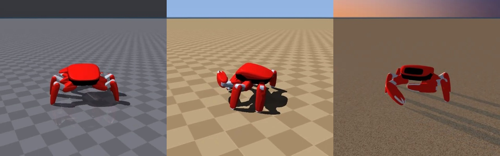

# jumper-gesture：比个手势，跳跳就动起来

用摄像头 + YOLO 手势识别，实时控制螃蟹机器人「跳跳」的官方开源仿真：
比 ✋ 它挥钳打招呼，比 ✊ 它跳起来，比 ✌️ 它跳螃蟹舞。

本项目为[螃蟹机器人开源动作大赛](https://beunlimited.me/zh/events/crab-robot-challenge-2026)创作，
基于金钢科技开源的 [KingKongRobotics/jumper](https://github.com/KingKongRobotics/jumper)。
**不需要实体机器人，也不需要 NVIDIA 显卡**，一台 Mac / Linux / Windows 电脑加一个摄像头就能玩。



<!-- 录好演示后，把截图或 GIF 放到 docs/media/demo.gif，并在这里引用 -->

---

## 它是怎么工作的

```
摄像头 ──► YOLO 手势检测 ──► 稳定性过滤 ──► 手势→动作映射 ──┐
（主进程，OpenCV 窗口）   （连续几帧才算数）  （config/gestures.yaml）│
                                                              ▼ 队列
跳跳仿真画面 ◄── 渲染线程 ◄── MuJoCo 物理仿真 ◄── 官方部署控制器 ◄── 动作→按键
（共享内存）              （仿真子进程）        （官方 jumper.app） （按当前模式排期）
```

关键点只有一个：**官方动作包本来就是靠按键切换动作的**。

官方示例动作包 `jumper.app` 内置了 12 个用强化学习训练好的动作，在 MuJoCo 窗口里按键盘就能切换
（`1` 挥手、`2` 鞠躬、`3` 伸爪、`4` 敬礼、空格 跳跃、`Ctrl+1~4` 四支舞……）。
本项目做的事情是：让摄像头"替你按键"。识别到手势后，调用官方的
`mjrl.viewer.keys.dispatch()` 发送按键，按键进入官方的部署控制器（真机板端跑的也是同一套控制器），
再由预训练策略在物理仿真里执行。**没有修改官方代码，也没有重新训练任何动作。**

几个细节：

- **防抖**：同一手势连续出现约 0.2 秒才触发；手放下后才能再次触发同一手势，一直举着不会反复触发。
- **按模式排期**：固定动作（挥手、鞠躬等）只能从站立状态进入。正在跳舞时比 ✋，程序会先发"停止"，
  等跳跳回到站立，再发"挥手"。跳跃过程中不能打断（官方设计），这时的手势会被忽略。
- **两个进程**：摄像头和识别在主进程，仿真在子进程，互不拖慢。macOS 上 OpenCV 窗口必须在主线程，
  这样也正好满足。
- **提速**：仿真里跳过了 dToF 深度传感器。在这种运行方式下没有任何东西读它，它却占了每步六成以上的耗时；
  跳过后 M1 Pro 上仿真能稳定跑满实时。
- **可重放**：每次会话都会记下发给控制器的每一个按键和对应时刻，事后可以离线以 1080p / 4K 重新渲染，
  动作和现场完全一致（见「录制与高清重放」）。

## 环境要求

| 项目 | 要求 |
|---|---|
| Python | 3.10 – 3.13（官方 jumper 仓库的要求，3.14 不行） |
| 系统 | macOS（Apple Silicon 实测）、Linux、Windows |
| 显卡 | 不需要。Mac 上 YOLO 走 MPS，约 8 ms/帧；纯 CPU 约 70 ms/帧，也能用 |
| 摄像头 | 笔记本自带的就行 |
| 磁盘 | 官方仓库约 550 MB，Python 依赖约 3 GB |

## 安装

两个仓库并排放在同一个目录下：

```
github/
├── jumper/            ← 官方仓库
└── jumper-gesture/    ← 本项目
```

```bash
# 1. 克隆两个仓库
git clone https://github.com/KingKongRobotics/jumper.git
git clone https://github.com/<你的用户名>/jumper-gesture.git
cd jumper-gesture

# 2. 建 Python 3.12 虚拟环境（推荐 uv：https://docs.astral.sh/uv/）
uv venv --python 3.12 .venv

# 3. 安装依赖：PyTorch → 官方 jumper → 本项目
uv pip install --python .venv/bin/python torch torchvision
uv pip install --python .venv/bin/python -e ../jumper
uv pip install --python .venv/bin/python -e ".[dev]"

# 4. 下载手势模型（约 22 MB）
.venv/bin/python scripts/download_model.py
```

> **国内网络**：在每条 `uv pip install` 后面加
> `--index-url https://pypi.tuna.tsinghua.edu.cn/simple`，速度会快很多。
> uv 不读 pip 的镜像配置，需要显式写出来。

> **不用 uv**：`python3.12 -m venv .venv`，再把上面的 `uv pip install --python .venv/bin/python`
> 换成 `.venv/bin/pip install` 即可。

> **Linux + NVIDIA 显卡**：第 3 步装 PyTorch 时用官方 CUDA 版本
> （`--index-url https://download.pytorch.org/whl/cu128`），其余不变。

装完自检：

```bash
.venv/bin/python -m pytest tests -q      # 逻辑测试，几秒钟
```

> **提示**：本文所有命令都写成 `.venv/bin/python`。如果你的 shell 里给 `python` 设了 alias，
> 激活虚拟环境后 `python` 仍可能指向系统 Python，写全路径最保险。
> Windows 上对应路径是 `.venv\Scripts\python`。

## 运行

```bash
.venv/bin/python -m jumper_gesture                       # 横屏 16:9
.venv/bin/python -m jumper_gesture --layout vertical     # 竖屏 9:16，适合抖音
```

第一次启动要加载仿真，大约 5–20 秒，窗口会显示 loading。之后左边是你（摄像头画面镜像显示，带识别框），
右边是跳跳，底部显示跳跳当前在做什么。

**macOS 第一次运行**会弹出摄像头授权；如果打不开摄像头，到「系统设置 → 隐私与安全性 → 摄像头」里
允许你用的终端（Terminal / iTerm / VS Code）。

窗口里的快捷键：

| 按键 | 作用 |
|---|---|
| `R` | 开始 / 结束录制 |
| `1` ~ `9` | 按映射表顺序手动触发手势（没有摄像头时调试用） |
| `Q` 或 `Esc` | 退出 |

想先不开摄像头试一下，可以用一段视频代替：

```bash
.venv/bin/python -m jumper_gesture --source 你的视频.mp4
```

### 识别效果更好的姿势

- 人离摄像头 0.5–1.5 米，手抬到胸口到脸的高度，**手掌正对镜头**；
- 光线充足，避免强逆光；
- 每个手势稳稳停住约半秒，别边移动边比；
- 跳跳的每个动作要 6–9 秒，一个动作做完再比下一个；要提前结束就比 ❌（双手交叉）。

## 手势映射表

默认映射在 [`config/gestures.yaml`](config/gestures.yaml)，改这个文件就能换玩法，不用改代码：

| 手势 | 模型类别名 | 跳跳动作 |
|---|---|---|
| ✋ 张开手掌 | `palm` | 挥钳打招呼 |
| 🙏 双手合十 | `holy` | 鞠躬 |
| 👍 点赞 | `like` | 敬礼 |
| 👌 OK | `ok` | 伸爪 |
| ✊ 握拳 | `fist` | 跳跃 |
| ✌️ 比耶 | `peace` | 螃蟹舞 |
| 🫶 双手比心 | `hand_heart` | 梦之翼舞 |
| 🤘 摇滚 | `rock` | 巴西舞 |
| ❌ 双手交叉 | `xsign` | 停下，回到站立 |
| ☝️ 食指指向 | `point` | 保持手势期间向前走 |

可用的动作（`action`）：

| action | 跳跳做什么 | 时长 | 备注 |
|---|---|---|---|
| `gesture_hello` | 挥钳打招呼 | 7.3 秒 | 只能从站立进入 |
| `gesture_bow` | 鞠躬 | 8.6 秒 | 只能从站立进入 |
| `gesture_paw` | 伸爪 | 6.4 秒 | 只能从站立进入 |
| `gesture_salute` | 敬礼 | 6.0 秒 | 只能从站立进入 |
| `jump` | 跳跃 | 约 1.8 秒 | 只能从站立进入，不能打断 |
| `dance_crab` | 螃蟹舞 | 约 4 分钟 | 可随时用 `stop` 打断 |
| `dance_brazilian` | 巴西舞 | 66 秒 | 同上 |
| `dance_maze` | 迷宫舞 | 10 秒 | 同上 |
| `dance_dream_wings` | 梦之翼舞 | 56 秒 | 同上 |
| `stop` | 停下，回到站立 | — | 对舞蹈和固定动作有效 |
| `walk_forward` / `turn_left` / `turn_right` | 向前走 / 左转 / 右转 | 手势保持多久就走多久 | 只在站立时有效；走路约 0.6 米/秒，转向很快（约 200°/秒） |

时长是官方动作包里动作本身的长度，切换时另有约 1 秒的过渡。

模型能识别的全部 33 种手势（来自 HaGRIDv2）：

`call` `dislike` `fist` `four` `like` `mute` `ok` `one` `palm` `peace` `peace_inverted` `rock`
`stop` `stop_inverted` `three` `three2` `three3` `two_up` `two_up_inverted` `grabbing` `grip`
`hand_heart` `hand_heart2` `holy` `little_finger` `middle_finger` `point` `take_picture`
`three_gun` `thumb_index` `thumb_index2` `timeout` `xsign`

每种手势的示意图见 [HaGRID 项目主页](https://github.com/hukenovs/hagrid)。
同一个文件里还有识别参数（置信度阈值、需要连续几帧等），注释里写了含义。

## 录制与高清重放

做视频推荐这样拍：

1. **现场录制**：运行时加 `--record`（或在窗口里按 `R`），会在 `recordings/session-时间/` 下生成：
   - `composite-*.mp4`：合成画面（你 + 跳跳 + 信息条），可以直接用；
   - `camera-*.mp4`：原始摄像头画面，剪辑时用；
   - `events.jsonl`：发给控制器的每一个按键和对应时刻；
   - `session.json`：这次用的场景、物理频率、相机参数。
2. **高清重放**：现场画面受实时性限制，分辨率不高。用会话目录离线重新渲染跳跳：

   ```bash
   .venv/bin/python -m jumper_gesture.replay recordings/session-20261004-160000 \
       --width 1920 --height 1080 --fps 60
   ```

   输出 `replay-1920x1080.mp4`，只有仿真画面，动作和现场一模一样（仿真是确定性的）。
   不需要实时，所以 4K 也可以，只是渲染慢一些。还可以用 `--camera-azimuth` 等参数换个机位重放。
3. **剪辑**：把 `camera-*.mp4` 和 `replay-*.mp4` 放进剪辑软件左右或上下拼。
   重放从仿真启动（tick 0）开始，摄像头视频从你开始录制时开始。`events.jsonl` 里 `record_start`
   那一行的 `tick` 就是两者的时间差：把重放视频的开头剪掉 tick ÷ 200 秒（官方动作包是 200 Hz），
   两段就对齐了。前提是录制时右下角的仿真速度保持在 1.00x。

## 常用参数

| 参数 | 默认值 | 说明 |
|---|---|---|
| `--source` | `0` | 摄像头编号，或视频文件路径 |
| `--layout` | `horizontal` | `horizontal` 横屏 1280×720；`vertical` 竖屏 720×1280 |
| `--scene` | `daylight` | 仿真场景，见下 |
| `--record` | 关 | 启动即录制 |
| `--fps` | `30` | 仿真渲染和录制帧率 |
| `--physics-hz` | `200` | 物理频率。200 与官方训练一致；1000 接触更精细，但更吃 CPU |
| `--camera-distance` / `--camera-azimuth` / `--camera-elevation` | `1.1` / `150` / `-18` | 跟拍相机的距离（米）、水平角、俯仰角（度） |
| `--config` | `config/gestures.yaml` | 手势映射表 |
| `--device` | 自动 | YOLO 推理设备：`mps` / `cuda:0` / `cpu` |
| `--jumper` | `../jumper` | 官方仓库路径，也可以设环境变量 `JUMPER_ROOT` |
| `--app` | 官方示例动作包 | 换成你自己打包的 `.app` |

场景（来自官方仓库）：`daylight` 蓝天暖色地面、`studio` 中性灰（适合截图）、`beach` 黄昏沙滩、
`default` 蓝灰棋盘格、`football` 小足球场。`ice`、`rubber`、`soft`、`rough` 会改变地面物理，
预训练动作在上面可能站不稳，正好可以拍"翻车"花絮。

## 项目结构

```
jumper-gesture/
├── config/gestures.yaml      手势 → 动作映射表、识别参数
├── jumper_gesture/
│   ├── app.py                主程序：摄像头、识别、画面合成、录制
│   ├── gestures.py           YOLO 检测 + 稳定性过滤
│   ├── driver.py             动作 → 按键，按跳跳当前模式排期
│   ├── actions.py            官方动作包的动作 / 按键对照表
│   ├── sim.py                仿真子进程（复用官方 play.py --app）、离线重放
│   ├── hud.py                画面合成与中文信息条
│   └── replay.py             高清重放命令行入口
├── scripts/download_model.py 下载 HaGRID 手势模型
├── tests/test_logic.py       不依赖仿真的逻辑测试
└── models/                   模型权重（不进 Git）
```

## 常见问题

**启动报"找不到官方 jumper 仓库"**：两个仓库要并排放，或者用 `--jumper /路径/到/jumper` 指定。

**`ModuleNotFoundError: No module named 'mjrl'`**：官方仓库没装进这个虚拟环境，重新执行
`uv pip install --python .venv/bin/python -e ../jumper`。

**右下角仿真速度明显低于 1.00x**：动作会变成慢动作。可以关掉其它占 CPU 的程序，降低 `--fps`，
或者换 `--scene default`（贴图最少）。成片建议用高清重放，不受这个影响。

**识别不准 / 误触发**：参考上面的「识别效果更好的姿势」；或在 `config/gestures.yaml` 里调高
`confidence` 和 `stable_frames`。映射表里只保留你要用的手势，误触发也会少很多。

**比了手势但跳跳没反应**：看底部提示。跳跃中不能打断；一个动作正在进行时比同一个手势会被忽略；
固定动作需要先回到站立，程序会自动先发"停止"再执行。

## 已知限制

- 这是**仿真**。官方文档说明，训练好的策略在真机板端的推理和电机驱动还没有完成验证，
  所以这里的效果不代表真机表现。
- 所有动作都来自官方示例动作包。想加新动作，需要用官方工具训练并打包成新的 `.app`，再用 `--app` 指定。
- 手势模型只认静态手势，不认挥手这类动态动作。

## 下一步可以做什么

- 用手的左右位置控制跳跳的行走方向；
- 手掌张开 / 握紧，映射成钳子的开合（官方动作包有左右钳模式）；
- 跳跳自带 500 万像素摄像头和 RK3576 芯片（6 TOPS NPU），Ultralytics 支持把 YOLO 导出成 RK3576 用的
  RKNN 格式，理论上可以把手势识别装进跳跳自己的"眼睛"里（未在真机上验证）。

## 致谢与许可

- [KingKongRobotics/jumper](https://github.com/KingKongRobotics/jumper)：跳跳的机器人模型、预训练动作、部署控制器和仿真框架（Apache-2.0）
- [HaGRID](https://github.com/hukenovs/hagrid)：手势数据集和 YOLOv10n 手势检测模型（署名 + 保留条件许可，基于 CC BY-SA 4.0）
- [Ultralytics](https://github.com/ultralytics/ultralytics)（AGPL-3.0）、[MuJoCo](https://github.com/google-deepmind/mujoco)（Apache-2.0）

本项目代码以 [GNU AGPL-3.0-or-later](LICENSE) 发布（因为直接依赖 Ultralytics），第三方说明见 [NOTICE](NOTICE)。
模型权重不随仓库分发，由 `scripts/download_model.py` 从 HaGRID 官方地址下载。
